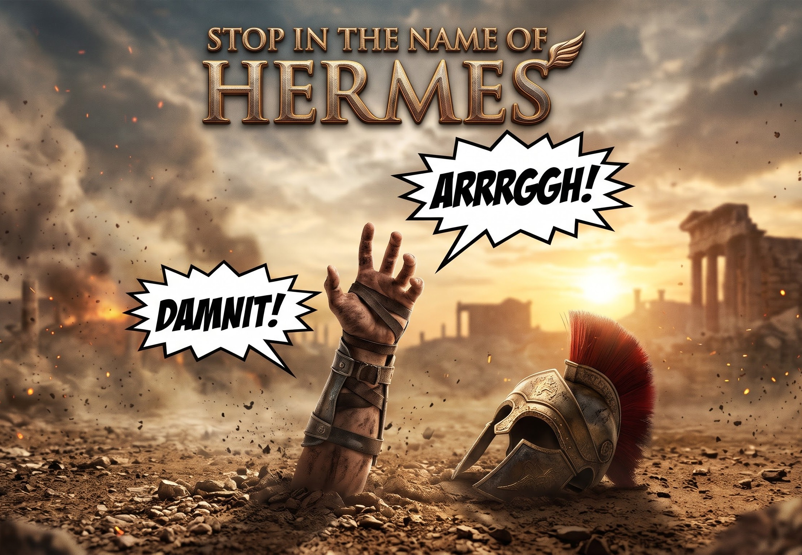

# hermesstop

**v1.0 Alpha** — Hermes desktop plugin built for the Nous Research **Hermes Agent Hackathon**.



Every time you hit the **Stop** button in the Hermes desktop composer, a speech bubble pops from the button shouting one of:

**DAMNIT!** · **GOD DAMN IT!** · **ARGH!** · **SON OF A…!** · **KIDDING ME?!** · **OH COME ON!** · **SERIOUSLY?!** · **NOT AGAIN!** · **FOR CRYING OUT LOUD!** · **I PITY THE FOOL!**

…or one of **2 custom words** you set yourself.

## Install

```bash
hermes plugins install shovexxx/hermesstop
```

Then enable it if needed (Capabilities ▸ Plugins) and press Ctrl/Cmd+K → **Reload desktop plugins**.

## Options page

Click the **stop-sign** button in the titlebar to open the options page; click
it again to close it back to the chat. The palette command
**HermesStop: open options** opens it too. The page has text fields for both
custom words, the bubble-style picker, and a test-bubble button.

## Bubble styles

Command palette (Ctrl/Cmd+K) → **HermesStop: bubble style: …**, or the style picker on the options page. The choice is saved and a preview bubble pops immediately.

| Style | Look |
|---|---|
| **Comic** | Classic white speech bubble, black outline, hard offset shadow |
| **Neon** | Dark panel with glowing green outline and text |
| **Minimal** | Quiet neutral pill, thin border, soft shadow |
| **Rect** | Clean rounded rectangle, black outline, hard offset shadow |
| **Stamp** | Tilted red rubber stamp, white type, hard shadow |
| **Pixel** | Retro handheld green, blocky monospace, pixel tail |

## Custom words

Command palette (Ctrl/Cmd+K) → **HermesStop: set custom word 1** / **set custom word 2** — or type them on the options page. Enter any word/phrase (40 chars max, blank clears it). Custom words are picked alongside the 10 presets.

## Test

Command palette → **HermesStop: show a test bubble** (uses your selected style), or the button on the options page.

## Uninstall

```bash
hermes plugins remove hermesstop
```
